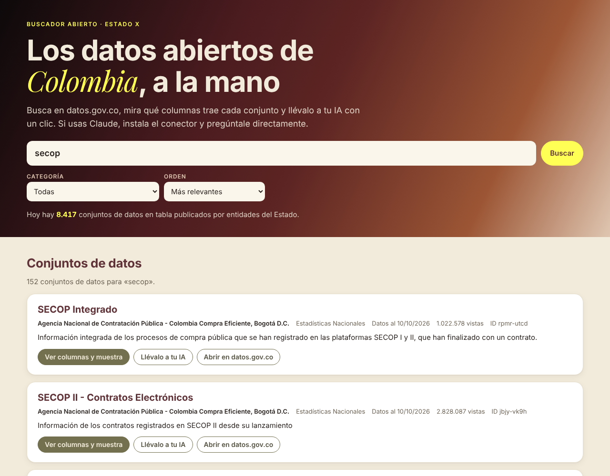

# Datos abiertos de Colombia

**[Español](#español) · [English](#english)**



## Español

Un **buscador web** y un **conector para Claude** que ponen a la mano los datos abiertos del Estado colombiano publicados en [datos.gov.co](https://www.datos.gov.co): contratos del SECOP, salud, educación, transporte, ambiente y miles más.

**Ábrelo aquí:** https://estado-x.github.io/datos-abiertos-colombia/

### Qué hace

**El buscador web** (para cualquier persona):

- Busca entre los conjuntos de datos en tabla de datos.gov.co, por palabras, categoría y orden (relevancia, más consultados o actualizados hace poco).
- Muestra quién publica cada conjunto, la fecha de los datos, sus columnas, cuántas filas tiene y una muestra de cinco filas.
- **«Llévalo a tu IA»** copia un texto listo para pegar en Claude, ChatGPT, Gemini u otra IA, con el nombre, la entidad, la fecha, las columnas y la dirección para consultarlo.

**El conector** (para Claude Desktop, Claude Code u otro cliente MCP) le da a la IA seis herramientas de solo lectura:

| Herramienta | Para qué sirve |
|---|---|
| `buscar_conjuntos` | Buscar conjuntos de datos por palabras, con filtros de categoría y entidad |
| `buscar_entidades` | Encontrar el nombre exacto con el que publica una entidad (alcaldía, ministerio…) |
| `ver_categorias` | Ver las categorías temáticas del portal |
| `ver_conjunto` | Ficha de un conjunto: entidad, fechas, licencia, filas y columnas con su nombre técnico |
| `consultar_datos` | Leer filas con filtros y orden, sin descargar el archivo |
| `contar_por` | Totales por grupo (filas y sumas), calculados por datos.gov.co aunque la tabla tenga millones de filas |

Ejemplo de pregunta: *«¿Cuántos contratos del SECOP II firmó cada departamento en 2026 y por cuánto?»*.

### Instalar el conector

Necesitas [uv](https://docs.astral.sh/uv/). El conector corre en tu computador; no hay servidor de por medio.

**Claude Code:**

```bash
claude mcp add datos-colombia -- uvx --from git+https://github.com/Estado-X/datos-abiertos-colombia datos-abiertos-colombia
```

**Claude Desktop** (en `claude_desktop_config.json`; en Windows está en `%APPDATA%\Claude\`):

```json
{
  "mcpServers": {
    "datos-colombia": {
      "command": "uvx",
      "args": ["--from", "git+https://github.com/Estado-X/datos-abiertos-colombia", "datos-abiertos-colombia"]
    }
  }
}
```

Reinicia Claude Desktop y verás las herramientas en el ícono de conectores.

**Como servidor HTTP** (para alojarlo tú o usarlo con otros clientes):

```bash
uvx --from git+https://github.com/Estado-X/datos-abiertos-colombia datos-abiertos-colombia --http --puerto 8000
# o con Docker
docker compose up -d
```

Queda en `http://localhost:8000/mcp`, con chequeo en `/health`. Por seguridad solo acepta llamadas a `localhost`; para un dominio propio, define `MCP_HOSTS_PERMITIDOS`. Las variables están en `.env.example`. El token de Socrata (`SOCRATA_APP_TOKEN`) es opcional y solo sube el cupo de consultas.

### Cómo funciona

- datos.gov.co funciona sobre la plataforma Socrata. El conector y el buscador usan sus servicios públicos, sin clave:
  - el catálogo (`api.us.socrata.com/api/catalog/v1`),
  - los metadatos (`www.datos.gov.co/api/views/<id>.json`),
  - las filas, con el lenguaje de consultas SoQL (`www.datos.gov.co/resource/<id>.json`).
- Solo habla con esas direcciones fijas. No descarga direcciones que le pasen y no escribe datos.
- El buscador es una página estática en `docs/`, publicada con GitHub Pages. Consulta datos.gov.co directamente desde el navegador de quien lo usa.
- Cada respuesta del conector trae la consulta reproducible, para que cualquiera pueda verificarla.

### Úsalo o adáptalo

1. Haz un fork de este repositorio.
2. Para el buscador, activa GitHub Pages (Settings → Pages → rama `main`, carpeta `/docs`).
3. Para el código del conector: `uv sync` y luego `uv run pytest` (pruebas sin internet) o `uv run pytest -m en_vivo` (contra datos.gov.co). Requiere Python 3.13.

¿Otro portal Socrata, de otro país o de una ciudad? Cambia `DOMINIO` en `datos_colombia/config.py` y en `docs/assets/buscador.js`.

### Límites

- Los datos son de cada entidad que los publica y **no están validados aquí**. Hay valores atípicos. Por ejemplo, algunas sumas de valores de contratos del SECOP dan cifras imposibles por errores de digitación en la fuente. Revisa antes de concluir.
- Solo incluye conjuntos de tipo tabla. Los mapas, gráficos y enlaces externos del portal no se consultan por filas.
- El buscador muestra lo que datos.gov.co responde en el momento: si el portal está lento o caído, el buscador también.
- No hay un servicio público alojado del conector: cada quien lo corre en su computador o en su propio servidor.

### Crédito

Adaptado de **[datagouv-mcp](https://github.com/datagouv/datagouv-mcp)**, el conector de la Dirección Interministerial de lo Digital de Francia (DINUM) para data.gouv.fr (licencia MIT). Se conservan su estructura de servidor, sus protecciones contra *DNS rebinding*, el chequeo de salud y el empaque con Docker. Los clientes de datos, las herramientas y el buscador web son nuevos. El detalle está en [CAMBIOS.md](CAMBIOS.md). El README original está en [README.original.md](README.original.md).

Datos: [datos.gov.co](https://www.datos.gov.co), portal de datos abiertos del Estado colombiano (MinTIC), con la licencia que indica cada entidad. Plataforma: Socrata (Tyler Technologies). Bibliotecas: [MCP Python SDK](https://github.com/modelcontextprotocol/python-sdk), [niquests](https://github.com/jawah/niquests) y [Uvicorn](https://www.uvicorn.org). Tipografía de acento: [Playfair Display](https://fonts.google.com/specimen/Playfair+Display) (SIL Open Font License).

Hecho por **[Estado X](https://estadox.com)** · Licencia MIT (la del proyecto original; ver [LICENSE](LICENSE)).

---

## English

A **web search page** and a **Claude connector** for Colombia's government open data on [datos.gov.co](https://www.datos.gov.co): public procurement (SECOP), health, education, transport, environment and thousands more.

**Open it here:** https://estado-x.github.io/datos-abiertos-colombia/

### What it does

**The web search page** (for anyone):

- Searches the tabular datasets on datos.gov.co by keyword, category and order (relevance, most viewed or recently updated).
- Shows each dataset's publisher, data date, columns, row count and a five-row sample.
- **"Llévalo a tu IA"** ("Take it to your AI") copies a ready-to-paste prompt for Claude, ChatGPT, Gemini or any other AI. The prompt includes the dataset's name, publisher, date, columns and query URL.

**The connector** (for Claude Desktop, Claude Code or any MCP client) gives the AI six read-only tools:

| Tool | What it does |
|---|---|
| `buscar_conjuntos` | Search datasets by keyword, with category and publisher filters |
| `buscar_entidades` | Find a publisher's exact name |
| `ver_categorias` | List the portal's themes |
| `ver_conjunto` | Dataset card: publisher, dates, license, rows and columns (technical names) |
| `consultar_datos` | Read rows with filters and sorting, no download needed |
| `contar_por` | Group totals (counts and sums), computed server-side by datos.gov.co |

### Install the connector

You need [uv](https://docs.astral.sh/uv/). It runs on your computer; there is no hosted server.

- **Claude Code:** `claude mcp add datos-colombia -- uvx --from git+https://github.com/Estado-X/datos-abiertos-colombia datos-abiertos-colombia`
- **Claude Desktop:** add the JSON block from the Spanish section to `claude_desktop_config.json` and restart.
- **HTTP server:** `datos-abiertos-colombia --http --puerto 8000` or `docker compose up -d`. It serves `http://localhost:8000/mcp`, with a health check at `/health`. It only accepts `localhost` by default; set `MCP_HOSTS_PERMITIDOS` for your own domain. The Socrata app token (`SOCRATA_APP_TOKEN`) is optional.

### How it works

- datos.gov.co runs on Socrata. Both the connector and the page use its public, keyless APIs: the catalog, the dataset metadata (`/api/views/<id>.json`) and SoQL queries (`/resource/<id>.json`).
- The connector only talks to those fixed addresses, never fetches user-supplied URLs and never writes data.
- The search page is static HTML in `docs/`, served by GitHub Pages. It calls datos.gov.co straight from the visitor's browser.
- Every connector answer includes a reproducible query URL.

### Use it or adapt it

Fork it. For the page, enable GitHub Pages (`main` branch, `/docs` folder). For the connector, run `uv sync`, then `uv run pytest` (offline) or `uv run pytest -m en_vivo` (live). It needs Python 3.13. To use another Socrata portal, change `DOMINIO` in `datos_colombia/config.py` and `docs/assets/buscador.js`.

### Limits

- Data belongs to each publisher and **is not validated here**. Outliers exist; some SECOP contract sums are impossible because of data-entry errors at the source.
- Only tabular datasets are included.
- The page reflects datos.gov.co in real time. If the portal is down, so is the page.
- There is no hosted public instance of the connector.

### Credit

Adapted from **[datagouv-mcp](https://github.com/datagouv/datagouv-mcp)**, the data.gouv.fr connector by France's Interministerial Digital Directorate (DINUM), MIT license. We kept its server structure, DNS-rebinding protection, health check and Docker setup. The data clients, the tools and the web page are new. See [CAMBIOS.md](CAMBIOS.md) for details. The original README is in [README.original.md](README.original.md).

Data: [datos.gov.co](https://www.datos.gov.co), Colombia's government open data portal (MinTIC), under each publisher's license.

Made by **[Estado X](https://estadox.com)** · MIT license (the original project's; see [LICENSE](LICENSE)).
